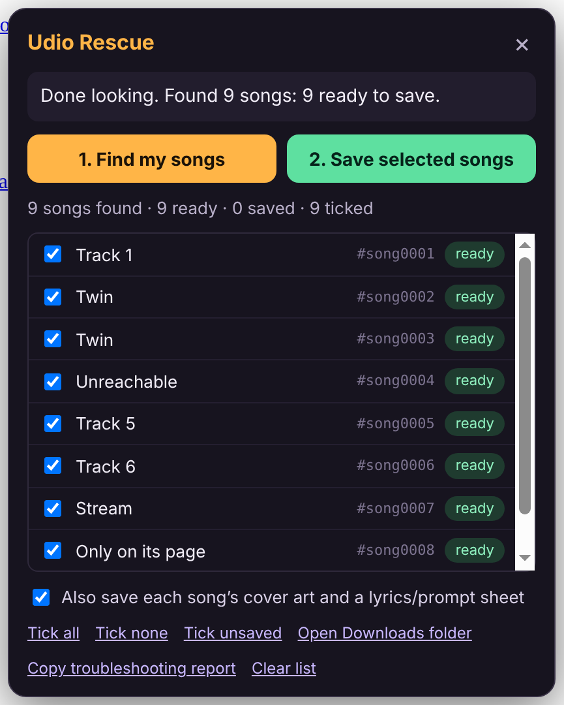

# Udio Rescue

Save copies of **your own Udio songs**, with their cover art, lyrics and
prompts, to your computer.

Udio switched off downloads in late 2025, but it still plays your songs to
you in your browser. Udio Rescue is a small Chrome extension that works the
same way your browser does: while you're logged in, it lists the songs in your
library and saves the audio Udio already sends you into a folder in your
Downloads.



## Before you start: please read

- **Use it only for songs you made.** It's meant for getting your own work
  back.
- **This goes against Udio's wishes.** Udio turned downloads off on purpose,
  and its terms may forbid tools like this. Using it could, in the worst case,
  get your account limited. Save what matters to you, then stop.
- **It never breaks protection.** If Udio protects (encrypts) a song's stream,
  the tool skips that song and tells you.
- **It keeps your data on your computer.** It sends nothing anywhere except to
  Udio itself, and it never reads your password.
- **It may need a fix.** Udio's site changes, and this tool was built without
  being able to see the live site. If it finds nothing, see
  [If something goes wrong](#if-something-goes-wrong).

## Install it (about 3 minutes, once)

Works in **Google Chrome**, **Microsoft Edge**, **Brave** and other
Chrome-based browsers on Windows, Mac or Linux. (Not Safari or Firefox.)

1. **Download the zip:**
   [udio-rescue-extension.zip](udio-rescue-extension.zip). On the GitHub page
   that opens, press the **Download** button (the down-arrow, top right).
2. **Unzip it.** Find the file in your Downloads, then double-click it (Mac) or
   right-click it and choose **Extract All** (Windows). You'll get a folder
   called `udio-rescue-extension`. Put it somewhere it can stay, such as your
   Documents, because Chrome loads the extension from this folder.
3. **Open the extensions page.** Type `chrome://extensions` in the address bar
   and press Enter. (In Edge, type `edge://extensions`.)
4. **Turn on "Developer mode".** It's a switch in the top-right corner (in
   Edge, on the left side).
5. **Press "Load unpacked"** and choose the `udio-rescue-extension` folder
   from step 2. (Choose the folder itself; you don't need to open it.)
6. "Udio Rescue" now appears in your list of extensions. You're done.

Optional: in Chrome's settings, under **Downloads**, turn **off** "Ask where
to save each file before downloading". Otherwise Chrome asks you about every
single song.

## Use it

1. Go to **udio.com** and log in.
2. Open **your library**: the page that lists the songs *you* made.
3. Press the orange **Udio Rescue** button in the bottom-left corner. (Clicking
   the extension's icon in Chrome's toolbar also opens it.)
4. Press **1. Find my songs**. The tool scrolls your library on its own, so
   Udio loads every song. Leave the tab open and let it finish. With a big
   library this can take a few minutes. You can press **Stop** at any time.
5. Look over the list. Every song is ticked. Untick any you don't want (for
   example, someone else's song that showed up on the page).
6. Press **2. Save selected songs**.

Your songs are saved in your **Downloads** folder, inside a folder called
**Udio Rescue**:

```
Downloads/
  Udio Rescue/
    Neon Rain [a1b2c3d4].mp3     ← the song
    Neon Rain [a1b2c3d4].jpg     ← its cover art
    Neon Rain [a1b2c3d4].txt     ← title, tags, prompt and lyrics
    Neon Rain [e5f6a7b8].mp3     ← the other version Udio made of that prompt
    library.json                 ← a list of everything saved
```

The code in `[brackets]` is the start of the song's Udio ID. Udio makes two
versions of every prompt with the same title, and the code keeps them from
overwriting each other.

**You can stop and come back.** The tool remembers what it found and what it
already saved. Next time, only unsaved songs are ticked, so you can do a big
library in several sittings.

## If something goes wrong

**A song says "no audio yet".** Press play on that song in Udio for a second
or two. The tool picks up the audio link as it plays, and the label turns to
"ready".

**It found no songs, or very few.** Make sure you're on your own library page,
then press **1. Find my songs** again. If it still finds nothing, Udio has
probably changed how its site works. Press **Copy troubleshooting report** and
paste the report to whoever is helping you (Claude, for example). The report
lists only which web addresses and field names Udio used. It never includes
your songs, lyrics, cookies or login.

**A song says "failed".** Hover over the red label to see why. "Protected
stream, skipped" means Udio encrypts that song's audio, and this tool won't
break encryption. For anything else, press **2. Save selected songs** again
later. Failed songs stay ticked.

**To remove the extension** when you're done: go to `chrome://extensions` and
press **Remove** on Udio Rescue. Your saved songs stay in your Downloads.

---

## How it works (for the curious)

| File | Job |
| --- | --- |
| `extension/inject.js` | Runs inside the Udio page. Reads (never changes) the replies Udio's own site receives, and notes the audio address when a song plays. |
| `extension/content.js` | The panel. Scrolls your library, picks the songs out of those replies, asks Udio for any missing audio links (`/api/songs?songIds=…`, then each song's own page), and sends the files off to be saved. |
| `extension/background.js` | Saves each file with Chrome's own downloader into `Downloads/Udio Rescue/` and reports back. |
| `extension/lib.js` | The pure logic: recognising a song wherever it turns up, safe file names, the lyrics sheet, reading HLS stream playlists. |

Udio has no public API, so the tool doesn't rely on any one address. It
recognises a song by its shape (an ID plus an audio link, or a title with
lyrics or a prompt) in any reply or page it sees. Streamed (HLS) songs are
rebuilt from their pieces. Encrypted streams are refused.

## Developing

```sh
node udio-rescue/tests/udio-rescue.test.js   # logic tests, plain Node, < 1 s
node udio-rescue/tests/e2e.cjs               # real Chromium + the extension vs a pretend Udio
python3 udio-rescue/build-zip.py             # rebuild the zip after changing extension/
```

The end-to-end test needs Chromium (`CHROME=/path/to/chrome`, or Playwright's
own installed) and `openssl`. It starts an HTTPS server that plays both
`www.udio.com` and an audio CDN, loads the real extension, presses the
buttons, and checks the files that land on disk. Its pretend library covers
infinite scroll, songs without audio links, a streamed song, an encrypted
stream, and a file Chrome's downloader is refused. Set `SCREENSHOT=out.png`
to capture the panel.

CI (`.github/workflows/udio-rescue.yml`) runs all three, and fails if the zip
is out of date.

Udio Rescue is a standalone project. It isn't part of MAZ ARCADE and doesn't
use the Maz engine.
